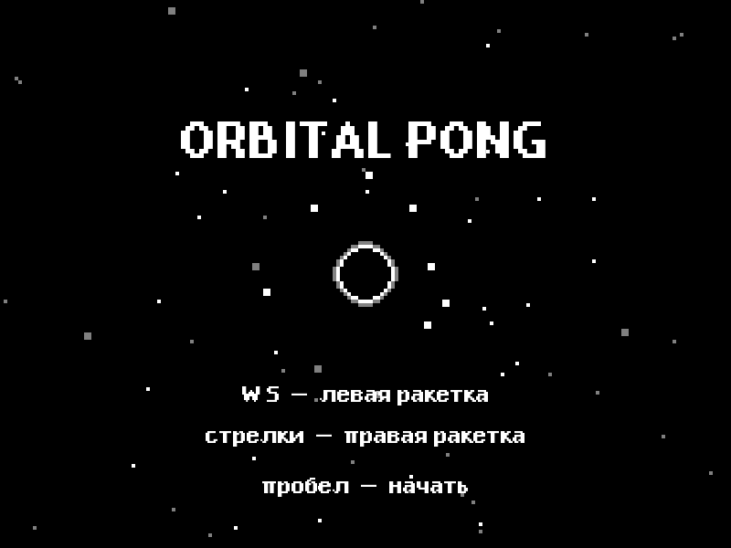
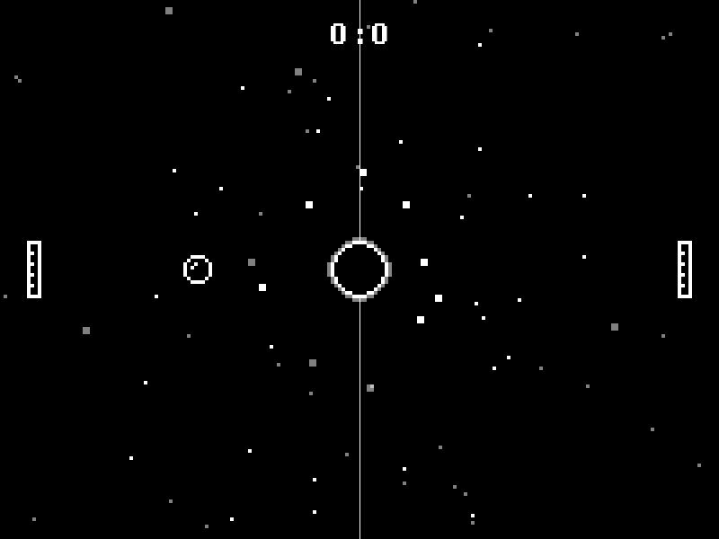
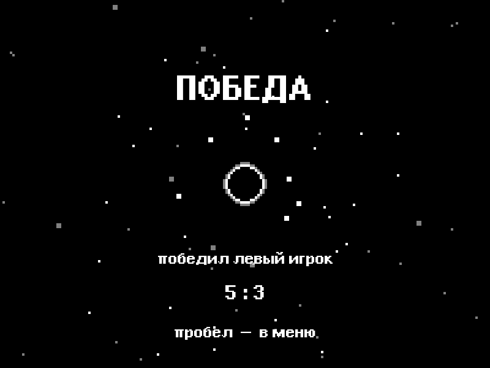

# Orbital Pong
## «Орбитальный Понг»

Orbital Pong — это пинг-понг на двоих. По центру поля стоит чёрная дыра. Она притягивает мяч, поэтому он летит не по прямой, а по дуге.

Партия идёт до 5 очков. Очко получает тот игрок, мимо ракетки которого мяч не пролетел.

---

## Стек технологий

- **Python 3.14**
- **Pygame-ce 2.5.8** — окно, отрисовка, клавиатура и звук

---

## Структура проекта

```
orbital_pong/
├── python_game/
│   ├── main.py          # запуск игры
│   ├── game.py          # цикл, управление, счёт, экраны
│   ├── settings.py      # размеры окна, гравитация, скорость
│   ├── ball.py          # мяч и притяжение к центру
│   ├── paddle.py        # ракетка
│   ├── black_hole.py    # анимация чёрной дыры
│   ├── effects.py       # след мяча и частицы
│   ├── level_loader.py  # загрузка и проверка level.json
│   ├── config.py        # чтение physics.cfg
│   ├── game_log.py      # лог событий (logging)
│   └── records.py       # таблица рекордов (CSV)
├── font/
│   └── EpilepsySansBold.ttf
├── sounds/
│   ├── space_song.ogg   # музыка
│   ├── bounce.ogg       # удар
│   └── score.ogg        # гол
├── level.json           # уровень (арена)
├── physics.cfg          # настройки физики
├── ball.png
├── paddle.png
├── black_hole.aseprite
└── screenshots/
```

### Назначение модулей

| Модуль | Назначение |
|--------|------------|
| `main.py` | Создаёт игру и запускает её |
| `game.py` | Меню, матч, победа, клавиши, звук |
| `settings.py` | Ширина, высота, FPS, сила гравитации |
| `ball.py` | Координаты мяча и формула притяжения |
| `paddle.py` | Движение ракетки и столкновение |
| `black_hole.py` | Кадры чёрной дыры из файла Aseprite |
| `level_loader.py` | Загрузка `level.json` с проверкой значений |
| `config.py` | Чтение `physics.cfg` |
| `game_log.py` | Лог событий в `pong_score.log` |
| `records.py` | Запись и чтение `records.csv` |
| `effects.py` | След мяча, пыль и частицы у дыры |

---

## Запуск игры

Запуск из папки `python_game`:

```bash
cd python_game
python main.py
```

---

## Управление

| Клавиша | Действие |
|---------|----------|
| `W` `S` | Левая ракетка |
| `↑` `↓` | Правая ракетка |
| `Пробел` | Начать партию или вернуться в меню |
| Закрыть окно | Выход |

---

## Механики игры

### Гравитация

В центре поля, в точке (400, 300), стоит чёрная дыра. Каждый кадр считается расстояние `d` от мяча до центра.

Если `d` больше 10, сила считается так:

```python
F = G / (d * d)
vx += F * (center_x - x) / d
vy += F * (center_y - y) / d
```

`G` лежит в `settings.py` и называется `GRAVITY`.

Мяч отскакивает от верхней и нижней границ окна.

### Ракетки и счёт

- Левая ракетка отбивает мяч вправо.
- Правая ракетка отбивает мяч влево.
- Если мяч ушёл за левый край, очко получает правый игрок.
- Если мяч ушёл за правый край, очко получает левый игрок.
- Игра заканчивается, когда у кого-то 5 очков.

---

## Интерфейс

### Стартовый экран

Название игры и подсказка по клавишам. Партия начинается по пробелу.

### Игровой экран

Две ракетки, мяч, чёрная дыра и счёт сверху.

### Экран победы

Надпись «ПОБЕДА», имя победителя и итоговый счёт. Пробел возвращает в меню.

---

## Настройки

Числа игры лежат в `python_game/settings.py`:

```python
WIDTH = 800
HEIGHT = 600
FPS = 60
GRAVITY = 500
PADDLE_SPEED = 6
WIN_SCORE = 5
```

---

## Скриншоты

### Стартовый экран



### Игровой процесс



### Экран победы



---

## Зависимости

Нужен Python 3.14 или новее и Pygame:

```bash
pip install pygame-ce
```

Проверка:

```bash
python -c "import pygame; print(pygame.ver)"
```

---

## Файлы данных (ЛР 2)

| Файл | Формат | Назначение |
|------|--------|------------|
| `level.json` | JSON | Уровень (арена): размер окна, позиция чёрной дыры, подача мяча, отступ ракеток, очков до победы. Читается при старте. |
| `physics.cfg` | INI | Настройки физики: `gravity`, `ball_mass`, `paddle_speed`. Читается при старте. |
| `pong_score.log` | текст | Лог событий с датой и временем. Создаётся и дополняется автоматически. |
| `records.csv` | CSV | Таблица рекордов: каждая завершённая партия дописывается строкой. |

### Уровень: `level.json`

```json
{
  "window": { "width": 800, "height": 600 },
  "black_hole": { "x": 400, "y": 300 },
  "serve": { "vx": 4, "vy": 2 },
  "paddle_margin": 30,
  "win_score": 5
}
```

- `window` - размер окна в пикселях (ширина 400..1920, высота 300..1080).
- `black_hole` - центр притяжения, должен лежать внутри окна.
- `serve` - скорость мяча при подаче в пикселях за кадр.
- `paddle_margin` - расстояние от ракетки до края окна.
- `win_score` - сколько очков нужно для победы (1..20).

Загрузка устроена в `python_game/level_loader.py` (`load_level`, `validate_level`):

- файла нет (`FileNotFoundError`): игра пишет предупреждение и берёт уровень по умолчанию;
- файл повреждён (`json.JSONDecodeError`) или не читается (`OSError`, `UnicodeDecodeError`): то же самое, игра не падает;
- в файле неверные значения (не число, не целое, вне диапазона, нет поля, дыра вне окна): неверное поле заменяется значением по умолчанию, остальные поля сохраняются, проблема попадает в лог.

### Физика: `physics.cfg`

```ini
[physics]
gravity = 500
ball_mass = 1.0
paddle_speed = 6
```

- `gravity` - гравитационная постоянная G в формуле `F = G / (d * d)`.
- `ball_mass` - масса мяча: ускорение `a = F / m`, тяжёлый мяч слабее притягивается.
- `paddle_speed` - скорость ракеток, пикселей за кадр.

Если файла нет, он испорчен или значение неверное (не число, не больше нуля), берётся значение по умолчанию (модуль `python_game/config.py`).

### Лог: `pong_score.log`

Лог пишет модуль `logging` (`python_game/game_log.py`), формат строки: `дата время.миллисекунды | УРОВЕНЬ | сообщение`.

```
2026-10-28 08:18:14.327 | INFO | Уровень загружен: окно 800x600, дыра (400, 300), до 5 очков
2026-10-28 08:18:14.432 | INFO | Партия началась, играем до 5 очков
2026-10-28 08:18:14.433 | INFO | ГОЛ: забил левый игрок | счёт 1:0 | скорость мяча 5.85 px/кадр (vx=5.50, vy=2.00)
2026-10-28 08:18:14.433 | INFO | ПОБЕДА: левый игрок, счёт 5:0, партия 63.2 с
2026-10-28 08:18:14.441 | INFO | Рекорд сохранён: Максим, счёт 5:0, 63.2 с
2026-10-28 08:18:21.812 | WARNING | Файл уровня не найден: ..., взят уровень по умолчанию
```

Записываются: запуск и выход, загрузка уровня и физики, ошибки файлов, начало партии, каждый гол (время, счёт, скорость мяча в момент пересечения линии ворот), победа, сохранение рекорда.

### Рекорды: `records.csv`

```
Дата,Имя,Счёт,"Время партии, сек"
2026-10-28 08:18:14,Максим,5:0,63.2
```

После победы игра просит ввести имя победителя (Enter сохраняет, пустое имя заменяется на «Игрок»). Результат дописывается в конец файла (режим `"a"`), при первом запуске файл создаётся с заголовками (`python_game/records.py`, функция `save_record`). На экране победы показывается топ-5 самых быстрых партий (`load_top`); повреждённые строки пропускаются.

### Почему JSON, INI и CSV

- JSON подходит для уровня: вложенная структура (окно, дыра, подача), числа и строки различаются по типам, формат читают и Python, и JavaScript (пригодится в следующих лабах).
- INI (`configparser`) подходит для плоских настроек «параметр = значение», его удобно править руками, и в нём можно оставлять комментарии.
- CSV подходит для таблицы рекордов: одна партия равна одной строке, файл можно дописывать, не читая целиком, и открыть в Excel.
- Лог - обычный текст: его удобно читать глазами и искать по нему.

### Как проверить

1. Удалить `level.json` и запустить игру: в консоли и в логе будет предупреждение, игра работает с уровнем по умолчанию.
2. Испортить `level.json` (например, убрать закрывающую скобку) - то же самое, но сообщение про повреждённый формат.
3. Поставить в `level.json` `"win_score": 2` - партия закончится на 2 очках.
4. Сыграть партию, ввести имя - появится `records.csv`, при следующей партии строки добавятся.
5. Открыть `pong_score.log` - там события игры с временем.

