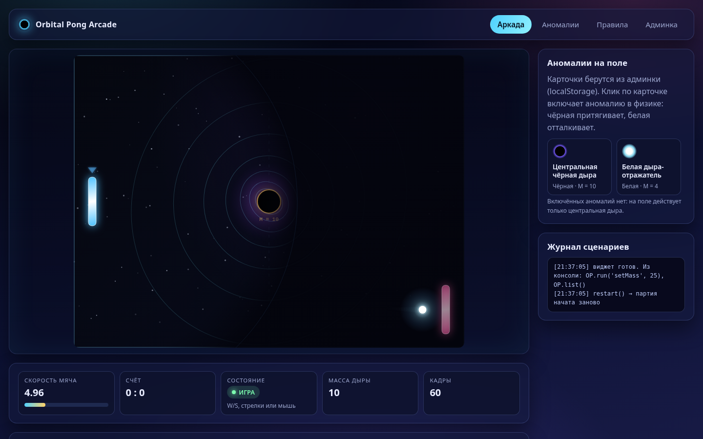
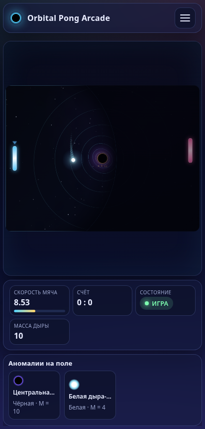
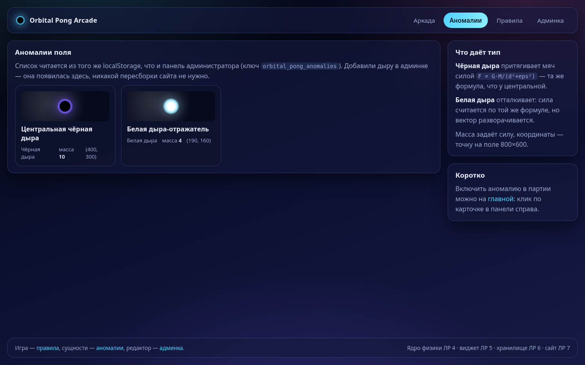

# Orbital Pong Arcade — сайт (ЛР 7)

**Студент:** Гакуть М.А., группа 25-СТ · **Предмет:** СЯП · **Вариант 15**

Многостраничный адаптивный сайт, который собирает в одно целое все части проекта:

* **ЛР 4** — математическое ядро на JavaScript (физика гравитации, классы, автомат состояний);
* **ЛР 5** — игровой виджет на Canvas (движок `mountWidget`, эффекты, HUD, сценарии);
* **ЛР 6** — панель CRUD «Космические аномалии» и её данные в `localStorage`;
* **ЛР 7** — этот сайт: каркас на Grid и Flexbox, хотбар сущностей, динамический HUD,
  glassmorphism-оформление и мобильная вёрстка со свайпами.

Ключевая идея: **сайт не дублирует игровой код**. Он импортирует виджет из `../widget/js/engine.js`,
а тот — ядро из `../js_core/js/`. Физика, отрисовка и ввод существуют ровно в одном экземпляре.



---

## Запуск

ES-модули не работают через `file://`, поэтому нужен статический сервер, запущенный
**из корня проекта** `orbital_pong` (сайт обращается к соседним папкам `widget/` и `js_core/`):

```bash
cd orbital_pong
python3 -m http.server 8000
```

Страницы:

| Адрес | Что там |
|---|---|
| <http://localhost:8000/site/> | Главная: игра, HUD, хотбар аномалий, журнал сценариев |
| <http://localhost:8000/site/anomalies.html> | Каталог аномалий из `localStorage` (плитки с параметрами) |
| <http://localhost:8000/site/rules.html> | Правила игры, управление, физика простыми словами |
| <http://localhost:8000/crud/> | Админка (ЛР 6) — источник данных для хотбара |

Внешних библиотек, CDN, сборщиков и шрифтов нет — только HTML, CSS и ES-модули.

---

## Структура

```
site/
├── index.html          # главная: шапка, навигация, канвас, HUD, хотбар, журнал, подвал
├── anomalies.html      # вторая страница: каталог аномалий
├── rules.html          # третья страница: правила и физика
├── css/
│   └── style.css       # переменные темы, Grid/Flexbox-каркас, glassmorphism, медиазапросы
├── js/
│   ├── main.js         # точка входа главной: сборка движка, хотбара, кнопок, свайпов
│   ├── site-hud.js     # HUD сайта: полоса скорости, счёт, «пилюля» состояния, масса, FPS
│   ├── storage.js      # чтение аномалий из localStorage (ключ ЛР 6) и подписка на изменения
│   ├── anomaly-cards.js# карточки хотбара и плитки каталога (textContent — XSS-безопасно)
│   ├── nav.js          # бургер-меню: открытие/закрытие, Esc, клик мимо
│   ├── swipe.js        # Touch Events: свайп по полю двигает ракетку (вариант 15)
│   ├── anomalies.js    # логика страницы каталога
│   └── rules.js        # логика страницы правил (только меню)
├── README.md
├── screenshot-desktop.png
├── screenshot-anomalies.png
└── screenshot-mobile.png
```

Ниже по тексту — зачем каждый файл нужен и как он связан с остальными.

---

## Каркас: Grid для страницы, Flexbox для панелей

Требование — «каркас строго через CSS Grid и Flexbox». Разделение такое:

* **Grid** — крупные области страницы. В `style.css` у `.site-shell`:

```css
.site-shell {
    display: grid;
    grid-template-columns: minmax(0, 1fr) 320px;
    grid-template-rows: auto 1fr auto;
    grid-template-areas:
        "header header"
        "main   side"
        "footer footer";
    gap: 18px;
    min-height: 100vh;
    max-width: 1440px;
    margin: 0 auto;
}
```

  `grid-template-areas` читается как схема страницы: шапка во всю ширину, содержимое слева,
  боковая панель справа, подвал во всю ширину. На планшете (≤1080 px) боковая колонка
  сужается, на телефоне (≤880 px) каркас перестраивается в одну колонку.

* **Flexbox** — внутри областей: `.site-header` (лого и меню в строку), `.site-main`
  (канвас, HUD и кнопки в столбец), `.hud` (карточки показателей в строку с переносом),
  `.btn-row`, `.hotbar` (горизонтальная прокрутка карточек), `.cards-grid` — а вот он Grid,
  потому что это сетка плиток ровной высоты.

Смысл разделения: Grid отвечает за «где на странице», Flexbox — за «как элементы стоят
внутри своего блока».

---

## Оформление: glassmorphism

Стиль варианта 15 — «футуристический, Glassmorphism, размытие фона». Реализовано так:

* фон страницы — несколько `radial-gradient` поверх линейного градиента, закреплённый
  `background-attachment: fixed`, поэтому панели «плывут» над ним;
* все панели (`.panel`, `.site-header`, `.anomaly-card`, `.hud-card`) полупрозрачные:
  `background: rgba(20, 26, 60, 0.55)` плюс `backdrop-filter: blur(14px)` — сквозь панель
  видно размытый фон;
* тонкая светящаяся рамка `1px solid rgba(140, 170, 255, 0.22)` и мягкая тень
  `0 18px 40px rgba(0,0,0,0.45)` дают эффект стекла;
* палитра вынесена в переменные `:root` (`--bg-0`, `--accent`, `--line`, `--glass`…) —
  один файл стилей обслуживает все три страницы, поэтому тема единая.

Цвета не только украшение: состояния различаются визуально. Полоса скорости становится
красной при `speed ≥ 12`, «пилюля» состояния — зелёная в игре, серая в меню, розовая в конце
партии (через `[data-state]`).

---

## Интеграция виджета ЛР 5 (ES-модули)

На главной одна строка разметки:

```html
<canvas id="game" width="800" height="600"></canvas>
```

и весь код подключения в `js/main.js`:

```js
import { mountWidget } from '../../widget/js/engine.js';

const widget = mountWidget({
    canvas,
    hud,                                        // HUD сайта вместо HUD виджета
    logElement: document.getElementById('scenario-log'),
});
```

`mountWidget` из ЛР 5 поднимает цикл `requestAnimationFrame`, читает ввод, шагает ядро
ЛР 4 с фиксированным шагом и рисует сцену. Сайту остаётся передать свой HUD — движок
вызывает у него те же методы `countFrame()` и `update(now, game)`, что и у `Hud` из ЛР 5,
поэтому подменять ничего не пришлось.

`window.OP` тоже доступен, как на странице виджета: `OP.run('setMass', 25)`,
`OP.list()`, `OP.info()` работают и здесь.

---

## Хотбар аномалий из localStorage (ЛР 6)

`js/storage.js` читает ключ `orbital_pong_anomalies` — тот же, что пишет админка ЛР 6:

```js
const raw = localStorage.getItem('orbital_pong_anomalies');
```

Дальше `anomaly-cards.js` строит карточки: иконка (чёрная или белая дыра), имя, строка
`Чёрная · M = 10`. Требование варианта — «меню выбора аномалий, подгружаемое из CRUD».
Клик по карточке:

1. подсвечивает её рамкой (`.is-selected`) и снимает подсветку с остальных;
2. кладёт выбранную запись в состояние виджета: `widget.game.anomalies = [...]`;
3. пишет строку в журнал сценариев, чтобы было видно, что выбор применился.

Чёрная дыра притягивает мяч, белая — отталкивает (знак силы разворачивается в ядре
ЛР 4). Повторный клик выключает аномалию.

Данные не только читаются, но и отслеживаются: `watchAnomalies()` слушает событие
`storage`, поэтому если открыть админку **во второй вкладке** и добавить запись, карточка
появится на главной без перезагрузки. Удалённая в админке аномалия так же исчезает из
хотбара и отключается в физике.

Если `localStorage` пуст или испорчен, `loadAnomalies()` подставляет две записи по
умолчанию и пишет предупреждение в консоль — страница не падает.

---

## Динамический HUD

HUD — это пять карточек-панелек под игровым полем (на телефоне — четыре, FPS скрыт):

| Карточка | Откуда данные | Как меняется вид |
|---|---|---|
| Скорость мяча | `game.ball.speed` | число + полоса заполнения `speed / 20`, при `speed ≥ 12` полоса красная |
| Счёт | `game.leftScore` / `game.rightScore` | текст вида `3 : 2` |
| Состояние | `game.state` (автомат ЛР 4) | подпись и цвет «пилюли»: МЕНЮ / ИГРА / КОНЕЦ |
| Масса дыры | `game.mass` | число; в `title` — сила притяжения у мяча |
| Кадры | счётчик `countFrame()` | обновляется раз в 500 мс |

Важный принцип из задания: значения берутся из движка, а не считаются в DOM. `SiteHud`
не хранит свою физику — он только читает поля `game` и пишет их в `textContent` и
`style.width`. DOM-узлы создаются один раз в HTML, обновление не пересобирает разметку.

Обновление идёт каждый кадр, но запись в DOM ограничена: счётчик кадров — раз в 500 мс,
остальные значения — раз в 100 мс. Так HUD не вызывает лишних перерисовок браузера.

---

## Адаптивность

Три контрольные ширины:

1. **≤1080 px** — боковая колонка сужается, шрифты чуть меньше, канвас подстраивается.
2. **≤880 px (телефон)** — главное:
   * каркас становится одной колонкой, `grid-template-areas` переписывается на
     `header / nav / main / side`;
   * верхнее меню прячется, появляется кнопка-бургер `☰`;
   * второстепенное скрывается классом `.hide-mobile`: панель управления, журнал,
     подвал, карточка FPS, подсказка под состоянием;
   * высота страницы фиксируется `height: 100dvh` + `overflow: hidden` — прокрутки нет;
   * канвас вписывается в свободное место: `max-width: 100%; max-height: 100%;
     aspect-ratio: 4 / 3`, поэтому поле видно целиком при любом размере экрана;
   * HUD перестраивается в Grid из четырёх колонок и занимает одну компактную строку.
3. **≤560 px** — HUD в три колонки, ещё меньше отступы и шрифты.

Отдельная ветка `@media (max-width: 880px) and (max-height: 560px)` — телефон в
горизонтальной ориентации: панель аномалий убирается совсем, HUD сжимается, и всё поле
получает высоту экрана. Без неё на боку холст сжимался до нескольких десятков пикселей.

Бургер (`js/nav.js`) работает по-честному: `aria-expanded` переключается, `aria-controls`
указывает на меню, закрытие — по ссылке, по `Esc` и по клику мимо. Класс `.site-nav.is-open`
показывает выпадающий список.



---

## Свайпы вместо ракетки (вариант 15)

По варианту на телефоне управление ракеткой заменяется свайпами. `js/swipe.js` слушает
Touch Events прямо на канвасе:

```js
canvas.addEventListener('touchmove', (event) => {
    event.preventDefault();          // страница не прокручивается
    ...
}, { passive: false });
```

Координата касания приходит в CSS-пикселях, а игра живёт в своих 800×600, поэтому
`clientY` переводится через масштаб холста (`canvas.height / rect.height`). Центр ракетки
ставится под палец, координата ограничивается полем, а сглаживание сбрасывается, иначе
ракетка «догоняла» бы палец с задержкой. У `canvas` в CSS стоит `touch-action: none` —
жест не уходит в браузер.

Работает и на десктопе в режиме эмуляции тача, и на настоящем телефоне. Клавиатура и мышь
при этом продолжают работать: все три способа пишут в одно поле `game.left.y`.

---

## Страницы

**Главная (`index.html`)** — канвас, HUD, кнопки («Новая партия», «Масса ±5», «Кольца»),
хотбар аномалий и журнал сценариев. Партия стартует автоматически: `run('restart')` при
загрузке, чтобы на сайте не искать пробел.

**Аномалии (`anomalies.html`)** — читает тот же `localStorage` и рисует плитки с типом,
массой и координатами. Редактирования здесь нет специально: правка живёт в админке, а
сайт показывает то, что завёл администратор. Ссылка на админку — в меню.

**Правила (`rules.html`)** — как играть, управление на всех устройствах, физика простыми
словами: `F = G·M/(d² + eps²)`, зачем нужно `eps²` и почему кольца вокруг дыры ярче
рядом с ней.

Все три страницы используют один `css/style.css`, один набор классов шапки и подвала и
одно и то же меню, поэтому переход между ними ничего не «прыгает».



---

## Соответствие требованиям ЛР 7

| № | Требование | Где реализовано |
|---:|---|---|
| 1 | Многостраничный сайт, ≥2 страницы с общей навигацией и единым стилем | `index.html`, `anomalies.html`, `rules.html`; одна шапка с меню и один `css/style.css` |
| 2 | Каркас строго на CSS Grid и Flexbox, единое оформление | Grid — `.site-shell` с `grid-template-areas`; Flexbox — шапка, `.site-main`, `.hud`, `.hotbar`, `.btn-row`; тема в `:root` |
| 3 | Виджет ЛР 5 на главной, управление из виджета | `index.html` → `<canvas id="game">`; `js/main.js` → `mountWidget(...)` из `../../widget/js/engine.js`; ввод — `widget/js/input.js` |
| 4 | Хотбар карточек из `localStorage`, клик выбирает запись | `js/storage.js` (ключ `orbital_pong_anomalies`), `js/anomaly-cards.js` (`renderCards`, `markSelected`), `js/main.js` → `widget.game.anomalies` |
| 5 | Адаптивность: бургер, скрытие второстепенного, поле без прокрутки | `css/style.css` — медиазапросы 1080/880/560 px и `(max-height: 560px)`; `js/nav.js`; `height: 100dvh` + `overflow: hidden` |
| 6 | Динамический HUD из данных движка, вид меняется в реальном времени | `js/site-hud.js` — `update(now, game)`: полоса скорости с порогом, «пилюля» состояния, счёт, масса, FPS |
| 7 | ES-модули, запуск через статический сервер | все `js/*.js` — `import`/`export`; раздел «Запуск»: `python3 -m http.server` из корня `orbital_pong` |
| 8 | Структура `index.html`, `css/`, `js/`, README | дерево в разделе «Структура» |
| 9 | README с запуском, управлением, скриншотом | этот файл |

**Требования варианта 15 сверх общего списка:**

| Пункт варианта | Где |
|---|---|
| Сайт «Orbital Pong Arcade» с игровым Canvas-окном | `index.html`, `.arena` |
| Меню выбора аномалий из CRUD-модуля | хотбар `.hotbar` + `js/storage.js` |
| Панель,отображающая скорость мяча | `#speed-value`, `#speed-bar` в `js/site-hud.js` |
| Glassmorphism, размытие фона | `backdrop-filter: blur(14px)` во всех панелях, полупрозрачные фоны |
| Полная адаптация под мобильные | три медиазапроса + горизонтальная ориентация |
| Свайпы вместо ракетки (Touch Events) | `js/swipe.js` |

---

## Как проверить

1. **Запуск.** Из корня `orbital_pong`: `python3 -m http.server 8000`, открыть
   `http://localhost:8000/site/`. В консоли ошибок нет, партия начинается сама.
2. **Виджет.** Мяч летит по дуге, кольца вокруг дыры пульсируют, левая ракетка едет от
   `W`/`S`, стрелок и мыши.
3. **HUD.** Скорость меняется каждый розыгрыш; на разгоне полоса растёт и краснеет, счёт
   обновляется после гола, «пилюля» переключается МЕНЮ → ИГРА → КОНЕЦ.
4. **Хотбар.** В панели справа две карточки. Клик по «Белая дыра-отражатель» — рамка
   выделения, в журнале строка, мяч начинает отталкиваться от точки (190, 160).
   Повторный клик выключает аномалию.
5. **Связь с ЛР 6.** Открыть `http://localhost:8000/crud/` во второй вкладке, добавить
   аномалию — карточка появится на главной без перезагрузки.
6. **Админка.** Ссылка «Админка» в меню ведёт на страницу CRUD с тем же хранилищем.
7. **Мобильная вёрстка.** Сузить окно до 420 px: появляется бургер, панель управления и
   журнал скрыты, поле вписывается целиком, страница не прокручивается
   (`document.body.scrollHeight === innerHeight`). Бургер открывает меню, `Esc` закрывает.
8. **Свайпы.** В DevTools включить эмуляцию тача и провести пальцем по полю — ракетка
   идёт за пальцем, страница не скроллится.
9. **Остальные страницы.** «Аномалии» показывает плитки с параметрами из админки,
   «Правила» — текст и то же меню.
10. **Сценарии из консоли.** `OP.run('setMass', 40)` — кольца ярче, HUD показывает 40;
    `OP.run('setVisibility', 200)` — узкий обзор.

---

## Что можно назвать на защите

* Сайт ничего не копирует из предыдущих работ: ядро ЛР 4, виджет ЛР 5 и хранилище ЛР 6
  подключены как модули, поэтому физика и отрисовка существуют в одном экземпляре.
* HUD читает поля движка напрямую (`game.ball.speed`, `game.state`, `game.mass`) — если
  поменять формулу в ядре, панель покажет новые числа без правок в DOM-коде.
* Хотбар и каталог строят DOM через `textContent`, а не `innerHTML`: имя аномалии из
  `localStorage` не может выполнить скрипт.
* Адаптивность проверена измерением: на 420×860 поле 390×293, HUD 141 px, высота страницы
  ровно равна высоте окна — прокрутки нет.
