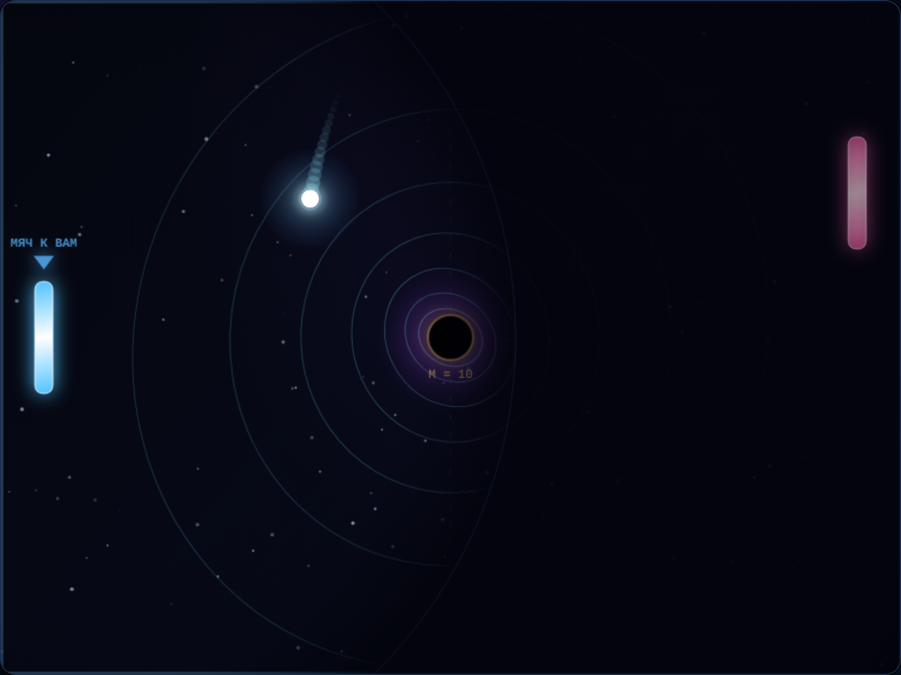

# Orbital Pong — веб-виджет на Canvas

Лабораторная работа № 5 по предмету «Системные языки программирования» (СЯП).
Вариант 15. Выполнил: **Гакуть М.А.**, группа **25-СТ**.

## Что это

«Orbital Pong» — пинг-понг на двоих на поле 800×600. В центре поля, в точке (400, 300),
стоит чёрная дыра: она притягивает мяч по закону тяготения, поэтому мяч летит не по
прямой, а по искривлённой траектории. Игрок управляет **левой** ракеткой мышью или
клавишами, **правая** ракетка — под управлением ИИ, который едет за координатой `y` мяча.

Виджет — это надстройка над готовым математическим ядром из ЛР 4. Ядро не копировалось
и не переписывалось: виджет импортирует его модули и добавляет к нему слой отрисовки,
ввода, эффектов и сценариев.

Что реализует работа (по варианту 15 и общим требованиям ЛР 5):

* игровой цикл на `requestAnimationFrame` с фиксированным шагом симуляции;
* ввод через **массив-флаги** зажатых клавиш и мышь как равноправный способ управления;
* анимацию эффектов с плавным изменением прозрачности `rgba` и радиуса;
* **ограниченную видимость** — уровень виден только в радиусе вокруг ракетки игрока;
* **индикаторы состояний** над ракеткой и над дырой;
* **вызываемые сценарии** — реестр именованных функций, доступный и из кнопок, и из консоли;
* **визуализацию искривления пространства** — концентрические орбитальные кольца вокруг
  чёрной дыры, прозрачность которых считается по силе гравитации (это и есть сценарий
  варианта 15).



---

## Запуск

Игра состоит из ES-модулей, поэтому открывать `index.html` двойным кликом (`file://`)
**нельзя**: браузер блокирует загрузку модулей с локального диска политикой CORS,
и в консоли появляется ошибка вида
`Access to script at 'file:///...' from origin 'null' has been blocked by CORS policy`.
Нужен любой статический сервер.

Из корня проекта `orbital_pong` (важно: именно из корня, потому что виджет импортирует
ядро по относительному пути `../js_core/js/...`):

```bash
cd orbital_pong
python3 -m http.server 8000
```

Затем открыть в браузере:

```
http://localhost:8000/widget/
```

Подойдёт и любой другой статический сервер (`npx serve`, Live Server в VS Code) — лишь бы
он отдавал файлы по HTTP и корнем был каталог `orbital_pong`.

Требования: браузер с поддержкой ES-модулей (Chrome, Firefox, Edge, Safari) и Canvas 2D.
Внешних библиотек, CDN, сборщиков и внешних шрифтов нет.

---

## Управление

| Действие | Клавиши | Мышь |
|---|---|---|
| Левая ракетка вверх | `W` или `↑` | движение курсора по холсту |
| Левая ракетка вниз | `S` или `↓` | движение курсора по холсту |
| Начать / перезапустить партию | `Space` | кнопка «Новая партия» |
| Рестарт | `R` | кнопка «Новая партия» |

**Мышь и клавиши равноправны.** Мышь двигает ракетку мгновенно, ставя её центр на высоту
курсора; клавиши двигают её на `PADDLE_SPEED = 6` px за шаг. Оба способа пишут в одно и
то же поле `game.left.y`, поэтому их можно чередовать хоть каждый кадр.

Одиночные нажатия (`Space`, `R`) обрабатываются с проверкой `event.repeat`, поэтому
удержание клавиши не перезапускает партию много раз в секунду.

Для клавиш `↑ ↓ ← →`, `Space`, `W`, `S` вызывается `preventDefault()` — страница не
скроллится и не «прыгает», пока идёт игра.

---

## Структура файлов

```
orbital_pong/
├── js_core/                    # ядро ЛР 4 — используется как есть
│   └── js/
│       ├── config.js           # CONFIG и MAX_FORCE
│       ├── game.js             # Game: физика, счёт, события
│       ├── bodies.js           # Ball, Paddle
│       ├── physics.js          # gravityForce, segmentHitsCircle…
│       ├── level.js            # уровень и его валидация
│       ├── rect.js, vector.js, state.js
└── widget/                     # ЛР 5 — этот виджет
    ├── index.html              # разметка: холст + HUD + кнопки сценариев + лог
    ├── screenshot.png          # скриншот работающего виджета
    ├── README.md               # этот отчёт
    ├── css/
    │   └── style.css           # тёмная тема, CSS Grid, адаптив
    └── js/
        ├── engine.js           # ЦИКЛ: rAF, аккумулятор, ввод→ядро→отрисовка, mountWidget()
        ├── widget.js           # подключение движка к странице ЛР 5 (тонкая точка входа)
        ├── input.js            # массив-флаги клавиш, keydown/keyup, preventDefault
        ├── mouse.js            # перевод координат мыши в координаты Canvas
        ├── effects.js          # модель эффектов: alpha, radius, жизненный цикл
        ├── render.js           # вся отрисовка Canvas: поле, дыра, кольца, туман…
        ├── hud.js              # обновление DOM-элементов HUD
        └── scenarios.js        # реестр сценариев, window.OP
```

### Зачем разделены `engine.js` и `widget.js`

`engine.js` — переиспользуемый **движок**: `export function mountWidget(config)` находит
элементы, поднимает цикл и возвращает небольшой API (`game`, `effects`, `scene`, `run`,
`start`). `widget.js` — **страница** ЛР 5: он только вызывает `mountWidget({canvas,
logElement})` и вешает `window.OP.widget` / `window.OP.run`. Такое разделение позволяет
подключить тот же движок к сайту ЛР 7, не дублируя цикл и физику.

Разделение ответственности внутри виджета:

| Файл | Отвечает за | Не знает про |
|---|---|---|
| `engine.js` | время, шаги, порядок «ввод → ядро → эффекты → отрисовка» | как рисуется пиксель |
| `input.js` | состояние клавиш | игру и физику |
| `mouse.js` | координаты курсора | физику |
| `render.js` | пиксели | ввод и физику |
| `effects.js` | жизненный цикл эффекта | Canvas |
| `hud.js` | DOM | Canvas и физику |
| `scenarios.js` | именованные действия | как устроен цикл |

---

## Параметры цикла

| Параметр | Значение | Где задано |
|---|---|---|
| Шаг симуляции `FIXED_DT` | **16.67 мс** (60 шагов/с) | `engine.js` |
| Максимум шагов за кадр | **5** | `engine.js`, `MAX_STEPS_PER_FRAME` |
| Защита от разрыва времени | `delta = min(now − last, 250 мс)` | `engine.js`, `MAX_FRAME_DELTA` |
| Радиус видимости | **420 px** по умолчанию (100…800) | `render.js`, `DEFAULT_VIEW_RADIUS` |
| Длина следа мяча | 15 точек | `render.js`, `TRAIL_LENGTH` |
| Количество колец | 8, радиусы 20…300 px | `render.js`, `RING_RADII` |
| Обновление HUD | раз в 100 мс, FPS — раз в 500 мс | `hud.js` |
| Обновление звёзд | 120 звёзд, создаются один раз | `render.js`, `makeStars` |

### Как устроен фиксированный шаг

Цикл рисует с частотой экрана, но **логика шагает равномерно**:

```js
function loop(now) {
    const delta = Math.min(now - last, MAX_FRAME_DELTA);  // защита после сворачивания вкладки
    last = now;
    accumulator += delta;

    while (accumulator >= FIXED_DT && steps < MAX_STEPS_PER_FRAME) {
        stepOnce();                    // один шаг физики, всегда 16.67 мс
        accumulator -= FIXED_DT;
        steps += 1;
    }
    // остаток аккумулятора превращается в коэффициент сглаживания
    const alpha = accumulator / FIXED_DT;
    requestAnimationFrame(loop);
}
```

Три следствия, которые и нужны по заданию:

1. **Скорость игры не зависит от fps.** На 144 Гц за кадр выполняется 0–1 шаг, на 30 Гц —
   примерно 2 шага, но за одну секунду в обоих случаях проходит 60 шагов, и мяч пролетает
   одинаковое расстояние.
2. **Ограничение в 5 шагов** не даёт «догоняющей» спирали смерти: если вкладка была
   свёрнута 10 секунд, игра не будет 600 шагов подряд пересчитывать физику и вешать
   страницу — она просто продолжит с текущего момента.
3. **Интерполяция.** Позиции мяча и ракеток сглаживаются между предыдущим и текущим
   шагом коэффициентом `alpha = accumulator / FIXED_DT`. Это косметика: физика всё равно
   считается только в `stepOnce()`, а `alpha` лишь делает движение плавным на мониторах
   с частотой выше 60 Гц. Скачки больше 120 px (подача после гола) не сглаживаются —
   иначе мяч «уезжал» бы через полполя.

### Замедление времени

Сценарий `slowMotion(k)` не трогает физику: он меняет интервал между шагами
(`FIXED_DT / k`). При `k = 0.5` шаг становится 33.3 мс, и мир идёт вдвое медленнее,
хотя каждый отдельный шаг по-прежнему считается ядром ЛР 4.

---

## Как устроена отрисовка колец (вариант 15)

Вокруг чёрной дыры рисуются 8 концентрических орбитальных колец с радиусами от 20 до
300 px. Прозрачность каждого кольца — это **нормированная сила гравитации на этом
радиусе**:

```
alpha(r) = min(1, gravityForce(mass, r) / MAX_FORCE(mass))
```

где `gravityForce` и `MAX_FORCE` берутся из ядра ЛР 4:

```
F(r)        = G · M / (r² + ε²)          — softening не даёт силе уйти в бесконечность
MAX_FORCE   = G · M / ε²                  — предел силы при r → 0
```

Отношение всегда лежит в (0, 1], и чем ближе кольцо к дыре, тем оно ярче. Это честная
физика: тот же закон, который двигает мяч, определяет и яркость колец. Поэтому при
изменении массы дыры сценарием `setMass` кольца перерисовываются в новом профиле.

### Почему нужна гамма-коррекция

Сила падает как `1/r²`, поэтому на больших радиусах сырая `alpha` физически верна, но
глазом не видна: при `M = 10` на `r = 300` она равна 0.0004. Поэтому к сырому значению
применяется гамма-сжатие, которое **сохраняет порядок** «ближе — ярче», но делает
разницу видимой:

```
displayAlpha(r) = 0.10 + 0.92 · alpha(r)^0.30
```

Значения при `M = 10` (первая колонка — радиус, вторая — сырая доля от максимума,
третья — то, что реально рисуется):

| Радиус, px | `alpha(r)` | `displayAlpha(r)` |
|---:|---:|---:|
| 20.0 | 0.083 | 0.53 |
| 29.4 | 0.040 | 0.45 |
| 43.4 | 0.019 | 0.38 |
| 63.8 | 0.009 | 0.32 |
| 94.0 | 0.004 | 0.28 |
| 138.4 | 0.002 | 0.24 |
| 203.8 | 0.001 | 0.21 |
| 300.0 | 0.0004 | 0.19 |

Функция отрисовки — `drawOrbitRings(ctx, hole, mass)` в `render.js`. Кольца медленно
вращаются (у каждого своя фаза) и слегка наклонены, из-за чего выглядят как орбиты, а не
как концентрические окружности. Цвет теплеет у горизонта событий и холодеет на периферии.
Сценарий `toggleRings()` включает и выключает кольца, не останавливая игру.

---

## Ограниченная видимость

Управляемая сущность — левая ракетка. Вокруг её центра рисуется круг радиусом
`viewRadius` (420 px): сначала рисуется **весь** мир, а потом поверх накладывается
радиальный градиент от `rgba(3, 4, 12, 0)` в центре до `rgba(3, 4, 12, 0.92)` за краем
радиуса. Градиент плавный, поэтому нет резкой границы «видно / не видно».

Мяч получает собственное свечение, которое рисуется **поверх** маски и пробивает туман:
без этого играть невозможно, потому что мяч большую часть времени находится вне радиуса
видимости. Правая ракетка тоже остаётся видимой, но приглушённой (`alpha = 0.42`).

Радиус меняется сценарием `setVisibility(px)` в диапазоне 100…800 px: `200` — «режим
подводной лодки», `800` — практически всё поле.

---

## Эффекты и их жизненный цикл

**Модель эффектов живёт в `effects.js`, рисует их `render.js`** — модель решает, *что*
должно быть на экране (радиус, прозрачность, живо ли ещё), виджет решает, *как* это
выглядит в пикселях.

У класса `Effect` есть поля `x, y, radius, maxRadius, alpha, life, maxLife, color, type`.
На каждом кадре `update(dt)`:

```js
this.life  = Math.max(0, this.life - dt);
this.alpha = Math.max(0, 1 - this.life / this.maxLife);   // 1 → 0
this.radius = this.maxRadius * easeOutCubic(progress);    // 0 → maxRadius
```

Когда `alpha` доходит до нуля, эффект удаляется из массива (`EffectSystem.update`
фильтрует погасшие). Никаких таймеров и `setTimeout` — всё живёт на общем игровом времени.

| Тип | Когда создаётся | Что видно | Время жизни |
|---|---|---|---|
| `spark` | удар мяча о ракетку (`paddle-hit`) | 7 коротких лучей из точки удара, цвет по стороне | 380 мс |
| `shockwave` | гол (`goal`), конец партии (`game-over`) | широкое расходящееся кольцо | 720 мс |
| `implosion` | мяч упал в дыру (`hole-catch`) | кольцо **сжимается** к центру и гаснет | 900 мс |

Источник событий — массив `game.events`, который копит само ядро ЛР 4. `engine.js` хранит
`lastEventCount` и разбирает только новые записи; `WeakSet` страхует от повторной
обработки, когда ядро обрезает массив до 200 элементов. Модель эффектов ничего не знает
о физике — она лишь реагирует на события.

---

## Индикаторы состояний

* **Маркер над левой ракеткой** — треугольник, который пульсирует
  (`Math.sin(time / 110)`), когда мяч летит в сторону игрока (`ball.vx < 0`). Цвет зависит
  от расстояния до мяча: дальше 200 px — синий `#59b7ff`, ближе 200 — жёлтый `#ffd24d`,
  ближе 100 — красный `#ff4d5e`. Когда мяч улетает, маркер гаснет до 45 % яркости.
* **«ПОГЛОЩЕНИЕ» над дырой** — пульсирующая подпись, которая появляется на 900 мс после
  события `hole-catch`.
* **Баннер конца партии** — «Победил игрок» или «Победил ИИ», итоговый счёт и подсказка
  «Space — новая партия», нарисованные на Canvas. Кнопка «Новая партия» в HTML делает то же.
* **Стартовый экран** в состоянии `MENU` — название, управление и приглашение нажать Space.

---

## HUD

HUD — это обычные DOM-элементы в правой колонке, а не надписи на Canvas. Значения
обновляются не каждый кадр, а раз в 100 мс (`FPS` — раз в 500 мс), чтобы не дёргать
layout 60 раз в секунду.

| Элемент | Показатель | Откуда берётся |
|---|---|---|
| `#hud-speed` | скорость мяча, px/кадр, 2 знака | `game.ball.speed` |
| `#hud-score` | счёт, `«3 : 2»` | `game.leftScore`, `game.rightScore` |
| `#hud-state` | МЕНЮ / ИГРА / КОНЕЦ с цветом | `game.state` |
| `#hud-mass` | масса дыры | `game.mass` |
| `#hud-fps` | реальные кадры/с | счётчик кадров `requestAnimationFrame` |
| `#hud-gravity` | сила притяжения, действующая на мяч | `gravityForce(mass, d)` из ядра |

Скорость показана в «пикселях за кадр» — это собственная единица ядра ЛР 4, где один
шаг физики равен одному кадру при 60 Гц.

---

## Сценарии

Сценарий — это именованная функция в объекте-реестре `scenarios` (`scenarios.js`). Один и
тот же реестр вызывается из трёх мест: из кнопок HTML (`data-scenario` / `data-arg`), из
консоли браузера через `OP.run(...)` и из самого виджета (например, `Space` вызывает
`restart`). Вся логика сценария живёт в реестре — обработчик кнопки ничего не знает о том,
что именно делает сценарий.

| Сценарий | Аргументы | Что делает |
|---|---|---|
| `restart()` | — | новая партия: счёт с нуля, мяч на подачу, эффекты очищены |
| `setMass(m)` | 0.1…1000 | масса чёрной дыры; пересчитывает притяжение и яркость колец |
| `setVisibility(px)` | 100…800 | радиус видимости вокруг левой ракетки |
| `toggleRings(on?)` | `true`/`false`/пусто | включает, выключает или переключает кольца |
| `slowMotion(k)` | 0.25…2 | множитель хода времени (не физики) |
| `fastBall(k)` | 1…5 | умножает скорость мяча на `k` |
| `freezeBall()` | — | обнуляет скорость мяча: он падает в дыру по чистой физике |
| `spawnAnomaly(type, x, y, mass)` | `'black'`/`'white'`, координаты, масса | добавляет **визуальную** вторую аномалию |
| `toggleAI()` | — | автопилот за левую ракетку |
| `showEvents()` | — | последние 10 событий ядра в лог-панель |
| `info()` | — | `{state, speed, leftY, mass, viewRadius, rings, …}` для проверки |

Все числовые аргументы обрезаются по диапазону, поэтому `setMass(-5)` не сломает игру,
а даст `0.1`. Каждый вызов пишется в лог-панель строкой вида

```
[21:04:12] setMass(25) → масса 25
```

### Из консоли браузера

```js
OP.run('setMass', 25)        // масса дыры 25
OP.run('setVisibility', 200) // узкий радиус видимости
OP.run('slowMotion', 0.25)   // почти замедленная съёмка
OP.run('spawnAnomaly', 'white', 600, 150, 8)
OP.info()                    // текущее состояние объекта
OP.list()                    // список всех сценариев
OP.widget                    // сам движок: game, effects, scene, run, start
```

`OP.run` проверяет существование сценария, ловит исключения, возвращает результат
(для `info()` — объект) и пишет строку в лог-панель. На неизвестное имя отвечает
предупреждением в консоль и в лог, а не падением страницы.

### Про `spawnAnomaly` — честно

Вторая аномалия **только рисуется**: у неё есть центр, радиус, свечение и подпись, но она
не участвует в расчёте ускорения мяча. Физика нескольких гравитирующих тел (сумма
векторов от каждой аномалии) — тема ЛР 7; ядро ЛР 4 считает притяжение к одной дыре,
и виджет его не подменяет.

---

## Интеграция с ядром ЛР 4

Ядро подключено относительными импортами с расширением `.js` — так требует браузер:

```js
import { CONFIG, MAX_FORCE } from '../../js_core/js/config.js';
import { Game }             from '../../js_core/js/game.js';
import { gravityForce }     from '../../js_core/js/physics.js';
```

Что именно берётся из ядра:

| Модуль ядра | Что использует виджет |
|---|---|
| `config.js` | `CONFIG` (размеры, скорости) и `MAX_FORCE` для нормировки колец |
| `game.js` | `Game` — вся физика, счёт, состояния, массив событий |
| `level.js` | `DEFAULT_LEVEL` — уровень по умолчанию |
| `physics.js` | `gravityForce` для кольца и HUD, `distance` |
| `state.js` | строки состояний `MENU` / `PLAY` / `OVER` через `game.state` |

**Логика не дублируется.** Виджет не содержит ни одной формулы движения: мяч двигает
`game.step(input)`, отскоки и голы считает ядро, события пишет `pushEvent`. Виджет только:

1. собирает ввод в объект `{leftUp, leftDown, rightUp, rightDown}` и передаёт его в `step`;
2. читает `game.events`, `game.ball`, `game.left`, `game.right` для отрисовки;
3. меняет только те поля, которые ядро оставляет открытыми (`game.mass`, `ball.vx`,
   `ball.vy`, `left.y` из мыши).

ИИ правой ракетки — это `game.right.track(game.ball.y)`, метод самого ядра, вызываемый
на каждом шаге в состоянии `PLAY`.

---

## Соответствие требованиям ЛР 5

| № | Требование | Где реализовано |
|---:|---|---|
| 1 | Виджет на Canvas, цикл через `requestAnimationFrame`, отрисовка примитивами | `engine.js` — `loop()`, `requestAnimationFrame(loop)`; `render.js` — `render()`, все фигуры через `arc`/`fillRect`/`stroke` |
| 2 | Фиксированный шаг симуляции (аккумулятор времени) | `engine.js` — `FIXED_DT = 1000/60`, `accumulator`, `while (accumulator >= stepInterval)`, не более 5 шагов за кадр |
| 3 | Ввод через массив-флаги, опрос в цикле, `preventDefault` | `input.js` — `const keys = []`, `keys['KeyW'] = true`, `PREVENT_DEFAULT`, `inputSnapshot()`; опрос — в `engine.js` → `stepOnce()` |
| 4 | Анимация эффектов: плавная прозрачность `rgba` и размер | `effects.js` — `Effect.update()` (`alpha = 1 − life/maxLife`, рост `radius`); `render.js` — `drawEffects()` |
| 5 | Ограниченная видимость вокруг управляемой сущности | `render.js` — `drawVisibility()` (радиальный градиент), вызов в `render()`; радиус — `scene.viewRadius`, меняется `setVisibility(px)` |
| 6 | Индикаторы состояний: анимированный маркер над сущностью | `render.js` — `drawThreatMarker()` (пульс `Math.sin`, цвет по дистанции), `drawAbsorbLabel()`, `drawBanner()` |
| 7 | Вызываемые сценарии: реестр, вызов из интерфейса и из консоли | `scenarios.js` — `scenarios`, `run()`, `list()`, `window.OP`; кнопки `data-scenario` в `index.html`, обработчик — `engine.js` → `wireButtons()` |
| 8 | Интеграция с ядром ЛР 4 через ES-модули, без дублирования | `engine.js` — `import { Game } from '../../js_core/js/game.js'`; формулы движения только в ядре |
| 9 | HUD — актуальные показатели в существующих DOM-элементах | `hud.js` — класс `Hud`, `update()` раз в 100 мс; элементы `#hud-*` в `index.html` |
| 10 | Запуск через статический сервер (не `file://`) | раздел «Запуск»: `python3 -m http.server`; ES-модули блокируются на `file://` политикой CORS |
| 11 | Структура `index.html`, `css/`, `js/`, разделение цикла/ввода/отрисовки/сценариев | см. «Структура файлов»: `engine.js`, `input.js`, `render.js`, `scenarios.js`, `effects.js`, `hud.js`, `mouse.js`, `widget.js` |
| 12 | `README.md` с запуском, управлением, таблицей сценариев, параметрами цикла, скриншотом | этот файл, `` |

---

## Как проверить

1. **Запуск.** Из корня `orbital_pong` выполнить `python3 -m http.server 8000` и открыть
   `http://localhost:8000/widget/`. В консоли должно быть две строки:
   `виджет готов. Из консоли: …` и `Orbital Pong widget: страница ЛР 5 готова`.
   Ошибок быть не должно.

2. **Старт.** Нажать `Space` — состояние в HUD меняется с «МЕНЮ» на «ИГРА», скорость мяча
   становится больше нуля, на поле появляется мяч со следом.

3. **Ввод.** Подержать `↓` — левая ракетка уезжает вниз (`OP.info().leftY` растёт).
   Подвигать мышь по холсту — ракетка следует за курсором. Убедиться, что страница при
   этом не скроллится.

4. **Сценарии из кнопок.** Нажать «Масса 25» — в HUD `Масса дыры` становится 25, кольца
   перерисовываются ярче, в логе появляется `setMass(25) → масса 25`.

5. **Сценарии из консоли.** Ввести `OP.run('setVisibility', 150)` — круг видимости
   сжимается. `OP.run('slowMotion', 0.25)` — игра заметно замедляется.
   `OP.run('toggleRings')` — кольца исчезают и появляются.

6. **Гравитация.** Выполнить `OP.run('freezeBall')` и подождать пару секунд: мяч с
   нулевой скоростью начинает падать к центру и через несколько шагов оказывается в дыре.
   Это видно по событию `hole-catch` в `OP.run('showEvents')` и по подписи «ПОГЛОЩЕНИЕ».
   Никакого «подталкивания» к дыре в коде нет — работает только `gravityAcceleration`
   из ядра.

7. **Эффекты.** Во время игры должны быть видны вспышки при ударах о ракетки, кольцо при
   голе и сжимающееся кольцо при попадании в дыру.

8. **Конец партии.** Играть до 5 очков — появляется баннер «Победил игрок» / «Победил ИИ»
   со счётом, `Space` начинает новую партию.

9. **HUD.** Показатель `FPS` держится в районе 60, `Сила гравитации` растёт, когда мяч
   подлетает к дыре, и падает, когда улетает к краю.

10. **Адаптив.** Сузить окно до ширины телефона — колонки складываются в одну, холст
    масштабируется и сохраняет пропорции 4:3.

---

## Протокол проверки

Проверка выполнялась в headless Chromium (Playwright) на странице
`http://localhost:8124/widget/`, поднятой командой `python3 -m http.server 8124`
из корня `orbital_pong`. Перед этим все модули прошли `node --check` (8 из 8 без ошибок).

| № | Что проверялось | Результат |
|---:|---|---|
| 1 | Загрузка страницы, наличие холста, `window.OP` и `OP.widget` | ок, стартовое состояние «МЕНЮ» |
| 2 | `Space` и 1.5 с игры | состояние «ИГРА», скорость 7.30 px/кадр |
| 3 | `ArrowDown` удержана 0.4 с | `leftY` 250 → 394 (сдвиг 144 px) |
| 4 | Прокрутка страницы при нажатых стрелках | `scrollY = 0`, `preventDefault` работает |
| 5 | Мышь на 80 % высоты холста | `leftY` → 429.82 (ожидалось 430) |
| 6 | `OP.run('setMass', 40)` | `info().mass = 40`, HUD «Масса дыры» = 40 |
| 7 | `OP.run('setVisibility', 200)` | `viewRadius = 200` |
| 8 | `OP.run('slowMotion', 0.5)` | `timeScale = 0.5` |
| 9 | `OP.run('freezeBall')` | событие `hole-catch` на кадре 182, скорость 23.41 — мяч упал в дыру по чистой физике |
| 10 | Клик по кнопкам «Масса 25» и «Кольца» | лог вырос с 16 до 18 строк: `setMass(25) → масса 25`, `toggleRings() → кольца выключены` |
| 11 | `#hud-fps` | 60 кадров/с (в допуске 30…250) |
| 12 | Игра до 5 очков | состояние «КОНЕЦ», счёт «5 : 2», баннер «Победил игрок» |
| 13 | `Space` после конца партии | новая партия, состояние «ИГРА» |
| 14 | Окно шириной 520 px | одна колонка (500 px), холст сохраняет 4:3 |
| 15 | Внутреннее разрешение холста | строго 800 × 600 |
| 16 | `OP.list()` | 10 сценариев |

**Ошибок в консоли — ноль.** Единственное предупреждение за весь прогон —
намеренный вызов несуществующего сценария `OP.run('nope')`, который проверяет обработку
ошибок: `run('nope') → нет такого сценария. OP.list() покажет список`.

Скриншот `screenshot.png` снят с холста в разрешении 1600×1200 (800×600 при
`device_scale_factor = 2`) в момент, когда мяч летит к игроку: на нём видны кольца вокруг
дыры, туман видимости слева, маркер «МЯЧ К ВАМ» и след мяча.
