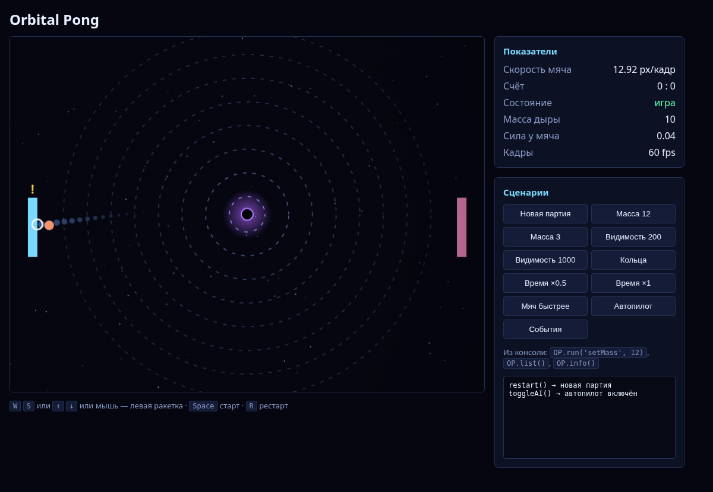

# Orbital Pong — веб-виджет на Canvas (ЛР 5)

ЛР 5 «Веб-виджет с вызываемыми сценариями JavaScript», вариант 15. Выполнил Гакуть М.А., группа 25-СТ.

Задание варианта: веб-виджет игры на Canvas. Игрок управляет левой ракеткой мышью или клавишами, правая ракетка управляется ИИ и едет за координатой `y` мяча. Сценарий JS рисует вокруг чёрной дыры концентрические орбитальные кольца, прозрачность которых зависит от силы гравитации.

Логика берётся из ядра ЛР 4 (`js_core/`) через ES-модули, без копирования. Виджет добавляет цикл, ввод, отрисовку, эффекты и сценарии.



## Запуск

ES-модули не работают через `file://`, нужен статический сервер. Запускать из корня проекта (виджет импортирует `../../js_core/...`):

```bash
cd orbital_pong
python -m http.server 8000
```

Открыть `http://localhost:8000/widget/`. Внешних библиотек и CDN нет.

## Управление

| Действие | Клавиши | Мышь |
|---|---|---|
| Левая ракетка вверх / вниз | `W` `S` или `↑` `↓` | движение курсора над холстом |
| Старт партии | `Space` | кнопка «Новая партия» |
| Рестарт | `R` | кнопка «Новая партия» |

Правая ракетка управляется ИИ: каждый шаг `game.right.track(ball.y)` двигает её к высоте мяча со скоростью `PADDLE_SPEED`.

## Структура

```
widget/
├── index.html         # холст, HUD, кнопки сценариев, лог
├── css/style.css      # тёмная тема, сетка «холст + панель»
├── screenshot.png
└── js/
    ├── widget.js      # цикл requestAnimationFrame, ввод, HUD, связка с ядром
    ├── render.js      # отрисовка: кольца, дыра, ракетки, мяч, туман, экраны
    ├── effects.js     # эффекты: прозрачность и радиус, жизненный цикл
    └── scenarios.js   # реестр сценариев
```

Что относится к модели, а что к представлению: модель — всё в `js_core/` (положение, счёт, события). Виджет только читает её и рисует. Эффекты живут по времени в `effects.js`, а `render.js` их рисует.

## Игровой цикл

- Цикл на `requestAnimationFrame`. Физика идёт фиксированным шагом `FIXED_DT = 1000 / 60` мс: реальное время копится в накопителе (`accumulator`), и пока в нём хватает на шаг, вызывается `game.step()`. На 30 и на 144 fps мяч летит с одной скоростью.
- За кадр делается не больше `MAX_STEPS_PER_FRAME = 5` шагов, а разрыв между кадрами обрезается до 250 мс: после паузы вкладки игра не «догоняет».
- Сценарий `slowMotion(k)` меняет длину шага: `FIXED_DT / k`.
- Порядок в кадре: накопитель → шаги ядра → эффекты → HUD → отрисовка.
- Ввод: объект `keys` хранит флаги зажатых клавиш (`keydown` ставит `true`, `keyup` — `false`), а на каждом шаге цикл опрашивает флаги. Для `W`, `S`, стрелок и `Space` вызывается `preventDefault()`. При потере фокуса окна флаги сбрасываются.

## Кольца и сила гравитации

Вокруг дыры рисуются 8 колец с радиусами 30…310 px. Прозрачность кольца считается по силе гравитации на его радиусе (`ringAlpha` в `render.js`):

```
share = min(1, F(r) / F_ref)        F(r) = G·M / (r² + ε²), F_ref = F(30) при M = 10
alpha = 0.08 + 0.9 · share^0.35
```

Степень 0.35 нужна, чтобы дальние кольца не пропадали: сила падает как `1/r²`. Порядок «ближе — ярче» сохраняется. Масса `M` берётся из игры, поэтому после `setMass` кольца меняются:

| Радиус, px | M = 2 | M = 10 | M = 12 |
|---:|---:|---:|---:|
| 30 | 0.59 | 0.98 | 0.98 |
| 110 | 0.29 | 0.45 | 0.47 |
| 190 | 0.22 | 0.33 | 0.35 |
| 310 | 0.18 | 0.26 | 0.27 |

Цвет задаётся строкой `rgba(130, 170, 255, alpha)`, а не `globalAlpha`: прозрачность вшита в цвет конкретной линии и не влияет на остальные рисунки.

## Эффекты и индикаторы

Эффект — объект с остатком жизни `life` и `alpha = 1 − прогресс`. Радиус растёт (или сжимается у `implosion`), прозрачность падает до нуля, после этого эффект удаляется (`EffectSystem.update`).

| Событие ядра | Эффект |
|---|---|
| `paddle-hit` | искра у ракетки и маркер «!» над ракеткой |
| `goal` | ударная волна у ворот |
| `hole-catch` | схлопывающееся кольцо у дыры и маркер «!» над дырой |
| `game-over` | большая ударная волна в центре |

События берутся из `game.events`: виджет запоминает, сколько уже обработал.

## Ограниченная видимость

После отрисовки мира поверх рисуется радиальный градиент с центром в левой ракетке: прозрачный в центре и тёмный на краю радиуса `viewRadius`. Это дешевле послойной маски: один градиент и один `fillRect`. По умолчанию радиус 1000 px (лёгкое затемнение дальнего края), сценарий `setVisibility(200)` показывает «туман» по-настоящему.

## HUD

В `index.html` заранее лежат элементы `hud-speed`, `hud-score`, `hud-state`, `hud-mass`, `hud-gravity`, `hud-fps`. Каждый кадр обновляется их `textContent`, новые элементы не создаются. Экран «меню» и экран результата партии рисуются на холсте.

## Сценарии

Сценарий — именованная функция из реестра в `scenarios.js`. Вызывается тремя способами:

1. кнопкой: `<button data-scenario="setMass" data-arg="12">`;
2. из консоли: `OP.run('setMass', 12)`;
3. через объект виджета: `OP.widget.run('setMass', 12)`.

`run` проверяет, что сценарий существует (иначе пишет в лог и в консоль список имён), ловит исключения и пишет строку в панель «лог».

| Сценарий | Что делает |
|---|---|
| `restart()` | новая партия, очистка следа и эффектов |
| `setMass(m)` | масса дыры 0.1…1000 |
| `setVisibility(px)` | радиус видимости 100…1200 |
| `toggleRings()` | включить или выключить кольца |
| `slowMotion(k)` | ход времени ×0.25…×2 |
| `fastBall(k)` | скорость мяча ×1…×3 |
| `toggleAI()` | автопилот за левую ракетку |
| `showEvents()` | последние события ядра в лог |
| `info()` | состояние виджета объектом |

Консоль: `OP.list()` — список имён, `OP.info()` — состояние.

Важно: при очень большой массе (около 15 и больше) подача сразу падает в дыру, а очки в этом случае не начисляются. Для игры подходят массы примерно до 12.

## Интеграция с ядром

```js
import { Game } from '../../js_core/js/game.js';
import { DEFAULT_LEVEL } from '../../js_core/js/level.js';
import { gravityForce, distance } from '../../js_core/js/physics.js';
```

Физика, счёт, автомат и события не дублируются: виджет вызывает `game.step(input)` и читает `game.ball`, `game.left`, `game.right`, `game.events`.

## Соответствие требованиям ЛР 5

| Требование | Где |
|---|---|
| Виджет на Canvas, `requestAnimationFrame` | `js/widget.js`, `js/render.js` |
| Фиксированный шаг | `FIXED_DT`, накопитель в `widget.js` |
| Ввод массивом-флагов | `keys`, `isDown`, `readInput` в `widget.js` |
| Анимация эффектов (alpha, радиус) | `js/effects.js`, `rgba` в `render.js` |
| Кольца с прозрачностью от силы | `ringAlpha` в `render.js` |
| Ограниченная видимость | `drawFog` в `render.js` |
| Индикаторы реакций | эффект `marker` |
| Реестр сценариев, вызов из UI и консоли | `js/scenarios.js`, `window.OP` |
| Интеграция с ядром | ES-модули из `js_core/` |
| HUD | `updateHud` в `widget.js` |
| Запуск через статический сервер | см. «Запуск» |

## Как проверено

Страница открыта в Google Chrome (headless) через `python -m http.server`: загружается без ошибок в консоли, идёт партия, HUD обновляется, клавиши `↓` и мышь двигают левую ракетку, эффекты появляются и исчезают, сценарии работают из кнопок и из консоли (`OP.run`, `OP.list`, `OP.info`), неизвестное имя сценария не роняет страницу. Скриншот — `screenshot.png`.
